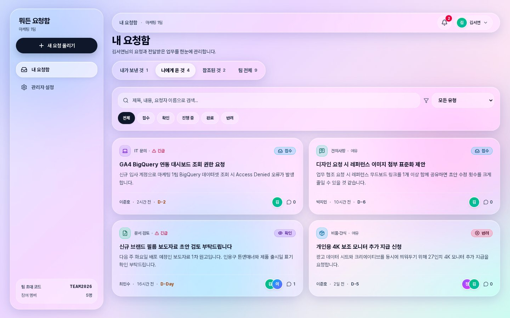
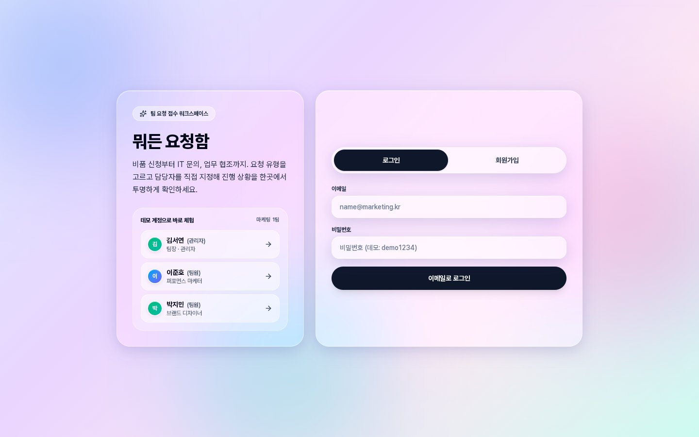
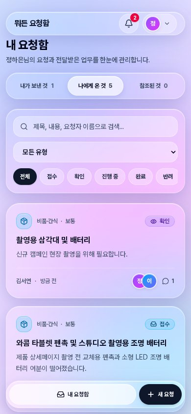
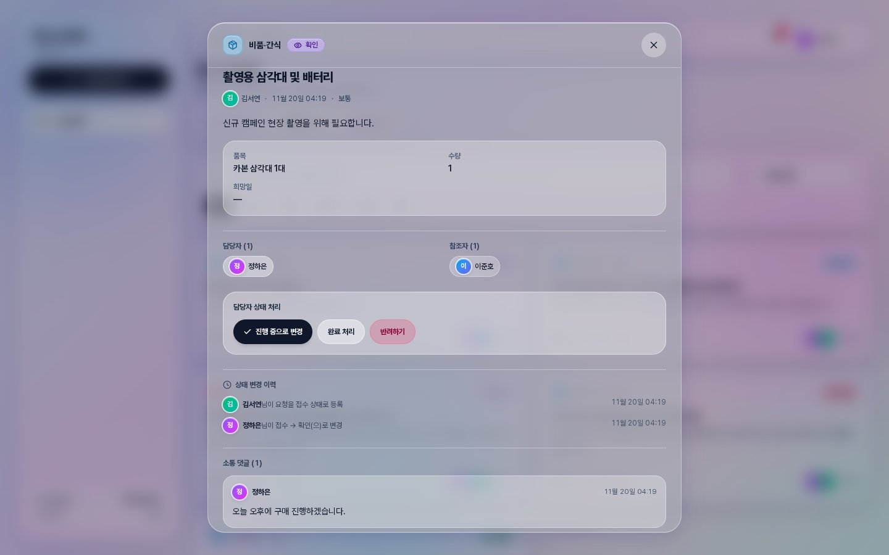
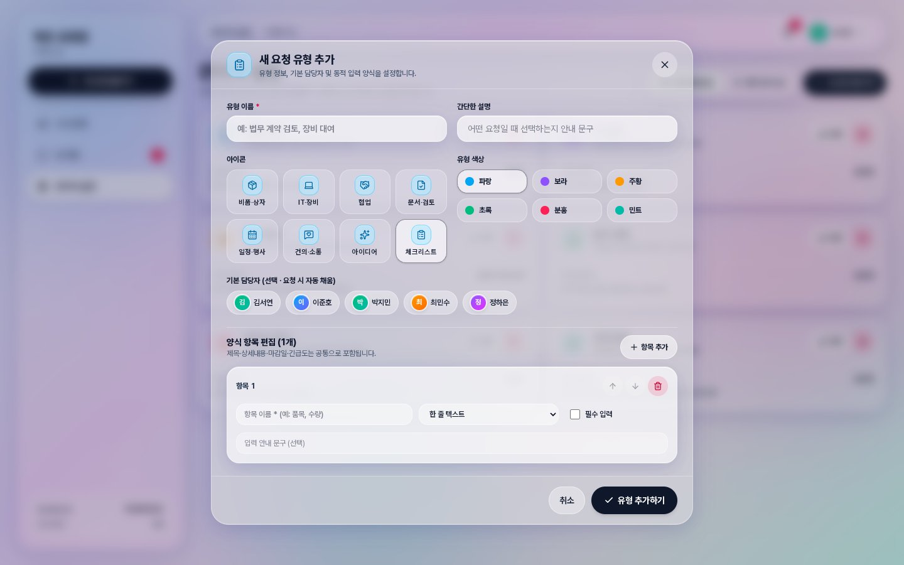
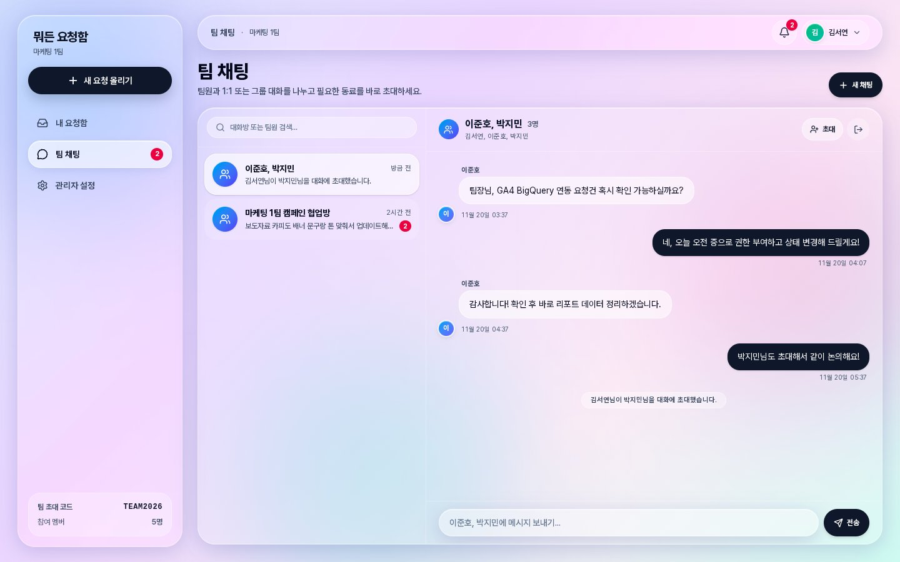

# 📮 Collabee

> 팀 안의 모든 요청을 한 곳에서 주고받는, 가벼운 팀 요청 접수 웹앱

**🔗 데모:** https://mintlovee.github.io/test-saas/

<p align="center">
  
</p>

---

## 소개

**Collabee**는 비품·간식 신청, IT 문의, 업무 협조, 문서 검토, 회의실 예약, 건의사항처럼 팀에서 오가는 요청을 한 곳에 모아 관리하는 웹앱입니다. 요청자가 **요청 유형을 직접 고르고, 전달할 사람을 직접 추가**하면, 받은 사람이 상태를 바꾸고 댓글로 소통합니다.

### 이름의 의미

**Collabee**는 **Collab**(Collaborate, 협업하다)과 **Bee**(꿀벌)를 합친 이름입니다. 부지런한 꿀벌들이 서로 일을 나누며 벌집을 꾸려 가듯, 팀원들이 요청을 주고받으며 함께 일하는 모습을 담았습니다.

### 제작 계기

팀에 요청이 올 때마다 단톡방, 메일, 구두로 흩어져서 누가 무엇을 부탁했는지, 어디까지 처리됐는지 찾기 어려웠습니다. 요청 관리 전용 도구는 우리 팀에 비해 기능이 많고 구독료도 부담이었습니다. 그래서 **필요한 만큼만 쓰는 가벼운 접수 창구**를 만들었습니다.

---

## 스크린샷

### 로그인과 데모 체험
<p align="center">
  
</p>

이메일 로그인과 회원가입을 지원하며, 데모 계정 버튼으로 바로 체험할 수 있습니다.

### 내 요청함 (데스크톱 / 모바일)
<p align="center">
  
  &nbsp;
  
</p>

탭(내가 보낸 것 / 나에게 온 것 / 참조된 것 / 팀 전체), 상태·유형 필터, 검색, D-day와 긴급도 표시를 제공합니다. 모바일에서는 하단 바로 이동하고 새 요청을 바로 올릴 수 있습니다.

### 요청 상세와 상태 처리
<p align="center">
  
</p>

담당자와 참조자, 유형별 입력값, 상태 변경 이력, 댓글을 한 화면에서 확인합니다. 담당자는 진행 중으로 변경, 보류(사유 입력), 완료 처리, 반려(사유 입력)를 선택할 수 있으며 모든 상태 변경 시 확인창을 거칩니다.

### 관리자: 요청 유형과 양식 편집기
<p align="center">
  
</p>

관리자가 요청 유형의 이름, 설명, 아이콘, 색상, **기본 담당자**를 정하고 입력 양식 항목(이름, 종류, 필수 여부, 안내 문구, 순서)을 직접 구성합니다.

### 팀 채팅
<p align="center">
  
</p>

요청에 대해 더 이야기하고 싶을 때 팀원과 1:1 또는 그룹 대화를 나누고, 필요한 동료를 바로 초대할 수 있습니다.

---

## 주요 기능

### 요청 보내기
- **유형 선택:** 비품·간식, IT 문의, 업무 협조, 문서 검토, 회의실·행사, 건의사항 등
- **유형별 입력 양식:** 유형을 고르면 해당 양식(품목, 수량, 증상, 파일 링크 등)이 나타남
- **전달할 사람 추가:** 팀원을 직접 추가하고 사람마다 역할 지정
  - **담당:** 실제로 처리하는 사람, 상태 변경 가능
  - **참조:** 알아야 하는 사람, 읽기와 댓글만 가능
- 마감일, 긴급도 설정

### 요청 처리
- **상태 흐름:** 접수 → 확인 → 진행 중 ↔ 보류 → 완료, 또는 반려 (모든 상태 처리 시 확인창 제공, 보류·반려 시 사유 입력 필수)
- 상태 변경 이력(누가, 언제, 무엇에서 무엇으로)과 댓글 스레드
- 새 요청, 상태 변경, 댓글에 대한 알림

### 팀 관리
- **팀 초대 코드**로 합류하거나 새 팀 만들기
- 역할: 관리자 / 일반 팀원
- 관리자 설정에서 요청 유형과 양식 편집
- 팀 채팅

---

## 권한 규칙

| 역할 | 할 수 있는 것 |
|---|---|
| 요청자 | 자기 요청 조회, 댓글 |
| 담당자 | 자기에게 온 요청의 상태 변경, 댓글 |
| 참조자 | 읽기, 댓글 |
| 관리자 | 요청 유형·양식 관리, 팀 전체 요청 조회 |

---

## 디자인

Apple의 **Liquid Glass** 스타일에서 영감을 받은 UI입니다.

- 부드러운 색 배경 위에 블러 처리된 반투명 유리 카드
- 둥근 모서리, 캡슐형 버튼과 탭, 아래에서 올라오는 모달
- 데스크톱은 사이드바 레이아웃, 모바일은 하단 바 레이아웃
- 모션 줄이기(`prefers-reduced-motion`) 설정 존중

---

## 기술 스택

| 구분 | 사용 기술 |
|---|---|
| 프레임워크 | React, TypeScript |
| 빌드 | Vite |
| 스타일 | Tailwind CSS v4 |
| 아이콘 | lucide-react |
| 배포 | GitHub Pages (GitHub Actions) |
| 데이터 | 브라우저 localStorage (아래 참고) |

> 이 프로젝트는 Google AI Studio로 프로토타입을 만들고 직접 다듬었습니다.

### 데이터 저장 구조

모든 데이터 읽기·쓰기는 `repository` 모듈 한 곳을 통해서만 이루어지도록 설계해서, 나중에 Firebase 같은 서버 DB로 **repository만 교체**하면 됩니다.

> ⚠️ 현재 데이터는 **각자의 브라우저에만 저장**됩니다. 여러 사람이 실제로 같이 쓰려면 서버 DB 연동이 필요합니다.

---

## 데모 체험

로그인 화면의 **데모 계정**을 눌러 바로 체험할 수 있습니다. (이메일 로그인 데모 비밀번호: `demo1234`)

| 계정 | 역할 |
|---|---|
| 김서연 | 팀장 · 관리자 |
| 이준호 | 팀원 (퍼포먼스 마케터) |
| 박지민 | 팀원 (브랜드 디자이너) |

**체험 순서**
1. 팀원 계정으로 **새 요청 올리기**를 눌러 유형을 고르고 전달할 사람을 추가합니다.
2. 전달받은 사람의 계정으로 바꿔 🔔 알림을 확인합니다.
3. 요청을 열어 상태를 **확인 → 진행 중 → 완료**로 바꿉니다.
4. 관리자 계정으로 **관리자 설정**에서 새 요청 유형을 추가해 봅니다.

---

## 로컬에서 실행하기

```bash
git clone https://github.com/mintlovee/test-saas.git
cd test-saas
npm install
npm run dev      # 개발 서버
npm run build    # 프로덕션 빌드
```

Node.js 22 이상을 권장합니다.

---

## 배포

`main` 브랜치에 push하면 GitHub Actions가 자동으로 빌드해서 GitHub Pages에 배포합니다.

- 설정: 저장소 **Settings → Pages → Source: GitHub Actions**
- Vite 설정의 `base`는 저장소 이름(`/test-saas/`)과 같아야 합니다.

---

## 로드맵

- [x] 로그인/회원가입, 팀 초대 코드
- [x] 요청 작성(유형 선택 + 전달할 사람 추가), 상태 변경, 댓글, 알림
- [x] 관리자용 요청 유형·양식 편집기, 기본 담당자
- [x] 팀 채팅
- [ ] 서버 DB 연동(Firebase 등)과 권한 규칙 적용
- [ ] 첨부파일 업로드
- [ ] AI 기능: 요청 자동 분류, 모호한 요청 보완 질문, 월간 리포트 요약

---

## 주의사항

- 데모의 계정, 팀, 요청, 채팅은 모두 **가상 데이터**입니다.
- 비밀번호는 데모 수준의 처리만 되어 있으므로 실제 비밀번호를 입력하지 마세요.
- 실제 팀에서 운영하려면 서버 인증, 데이터 암호화, 접근 권한 규칙이 필요합니다.
